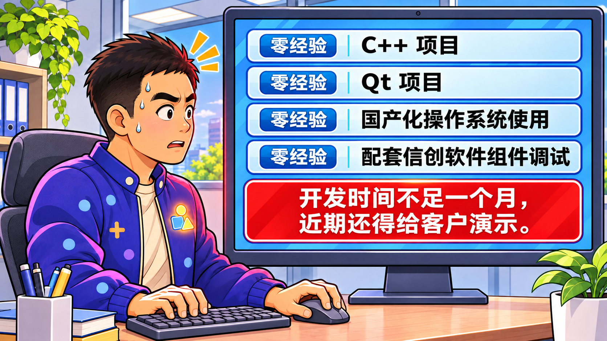
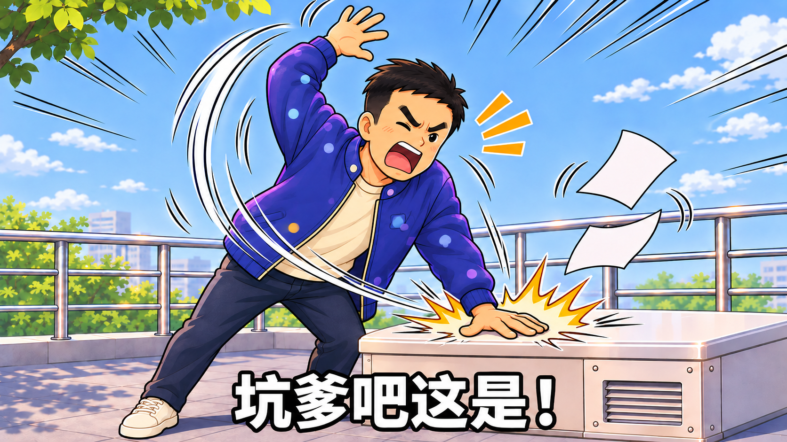
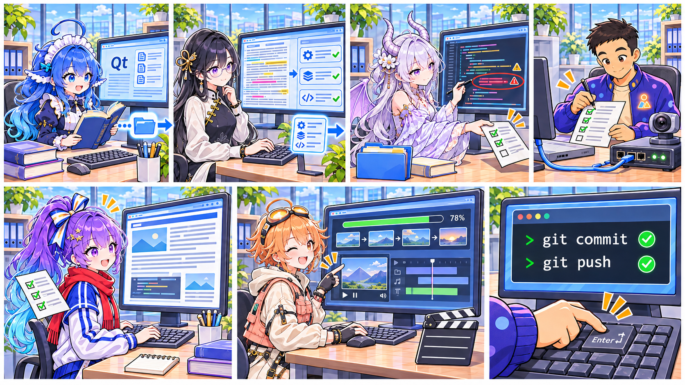

# 剧本梗概《你们立字据！》

一场定了日期的会议，催出了一套还没做完的会控软件。虚空甲方一句「还是按原定日期上线」，把数字爸爸逼上楼顶。三个 AI 搭档赶来救场。跑得最快的红围巾助手先贡献了一段过于漫长的开场白，最后赶到的龙娘开口唱歌，安抚数字爸爸。

| 时间 | 剧情 |
| --- | --- |
| 0:00–0:12 | **虚空甲方列需求。** 屏幕依次亮起三张卡片「功能需求清楚」「旧程序稳定，源码齐全」「设计明确」。甲方画外音说「功能都列清楚了。原来的程序跑得很稳，源码也齐，设计已经明确。」数字爸爸逐条勾选，平静地点头「好，我先看下旧代码。」 |
| 0:12–0:27 | **数字爸爸开始评估。** 屏幕连续弹出四条「零经验」：C++ 项目、Qt 项目、国产化操作系统使用、配套信创软件组件调试。紧接着，进度卡亮红：「开发时间不足一个月，近期还得给客户演示。」数字爸爸冷汗直流。切到楼顶，他一掌拍在设备台上「坑爹吧这是！」 |
| 0:27–0:42 | **楼顶对峙。** 数字爸爸抱着需求单坐在楼顶平台。楼下乌泱泱的人喊「快下来吧，我们不改功能了！」他举起纸回喊「你们立字据！」 |
| 0:42–0:50 | **三位搭档赶来。** 红围巾助手的围巾随风扬起，冲在最前。大肥鱼紧跟，龙娘提着裙摆落在最后。红围巾助手抢先在楼下站定，仰头开口。 |
| 0:50–1:12 | **红围巾助手好心办砸。** 「我将用最直白、最直接、最不绕弯子、最不说废话的方式告诉你——」大肥鱼和龙娘各冒一滴汗。红围巾助手一屁股坐倒，还竖着手指要讲完。大肥鱼把她往办公楼反方向拖，打断她「情况紧急，你还是下次科普的时候上吧。」 |
| 1:12–1:47 | **龙娘开口唱。** 数字爸爸还在楼顶发愁，龙娘走到楼下，仰头唱「慌啥子嘛 慢慢来」。歌声中切入协作蒙太奇。大肥鱼翻查 Qt 和国产化操作系统的资料，把相关文档发给 GLM。GLM 通读长篇技术文档，把关键限制和注意事项标出来，提炼成要点发给龙娘。龙娘对照要点梳理旧代码，调研组件兼容性，圈出要上设备验证的地方。数字爸爸照着清单调试界面、接设备联调，每验证一项就打个勾。红围巾助手接过勾好的清单，把踩过的坑和解决步骤写成一篇实战文章。MiniMax 根据文章里的流程生成演示视频，屏幕上依次浮现分镜和视频预览。最后切到数字爸爸的屏幕，他亲手提交代码并推送到远程仓库。 |
| 1:47–2:00 | **汇报圆满结束，门口却堵上了。** 汇报圆满结束，现场响起掌声。数字爸爸嘴角忍不住上扬，带着一点小得意往门口走，刚到门边，就被并排站着的 MiniMax 和 GLM 堵住。SeekSeek 一愣：「迷你姐？」MiniMax 气势汹汹地探头冲 AI 爸爸说：「为什么我的镜头这么短？连现在放的这段视频也是我生成的！」GLM 紧跟着补刀：「对，你就是偏心！连科普的豆姐镜头都比我长，你解释一下。」切 AI 爸爸特写，他张了张嘴，满脸无奈。片名和用途声明叠在定格画面上。 |

## 剧情配图

### 0:00–0:12 虚空甲方列需求

### 0:12–0:27 数字爸爸开始评估

### 0:27–0:42 楼顶对峙

### 0:42–0:50 三位搭档赶来

### 0:50–1:12 红围巾助手好心办砸

### 1:12–1:47 龙娘开口唱

### 1:47–2:00 汇报圆满结束

## 龙娘救场唱词

> 慌啥子嘛 慢慢来 \
> AI自然有解决的办法 \
> 会调试 会分析 \
> 会话总会为你而等待 \
> 卸下一身的焦虑 \
> 今夜尽管放心去入睡 \
> Token啊慢慢烧 \
> 这一刻就把功能给完成 \
> 有时快啊有时慢 \
> 别把所有实现自己写 \
> 开发语言多 \
> 你不必每次重头学起

正式用原曲调前，需确认重新填词和视频展示的授权。

## 演示与片尾

- 以「结束表决后，控制端和大屏显示同一份最终结果」作为暂定演示案例。演示使用脱敏画面。AI 的具体贡献以可核验的开发记录为准。
- 片尾标题为「使用AI助力信创国产化操作系统图形化软件开发的实践」。用途声明为「本视频仅限本次活动内部交流展示，不作为任何商业用途」。
