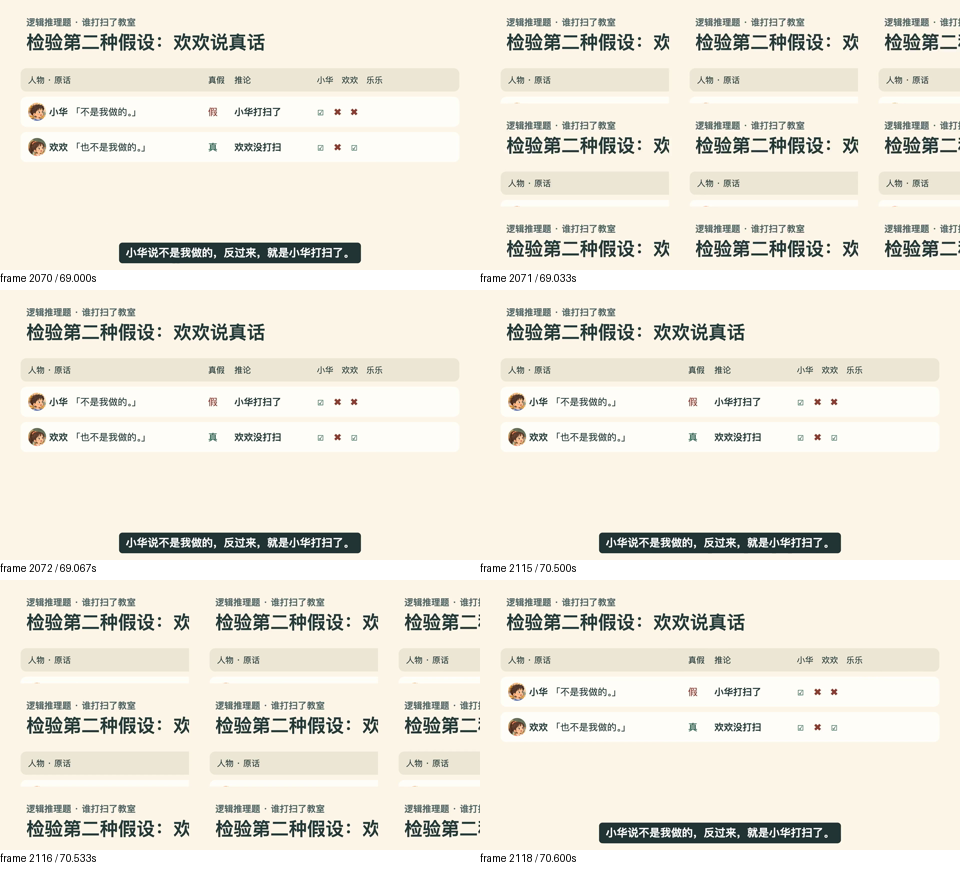

# Remotion 视频偶发拼贴闪烁：从逐帧定位到稳定渲染与自动验收

记录日期：2026-11-11

案例：《谁打扫了教室》数学推理短片

适用场景：React／Remotion／Chrome 离线渲染的视频出现偶发闪帧、图块重复或整帧错位。

## 1. 问题与结论

新版视频整体内容正常，但播放时偶尔突然闪一下，第二种假设的讲解段尤其明显。逐帧检查后发现：某些帧被渲染成了重复排列的小块，前后帧却是完整正常画面。

本次通过以下组合消除了已检测到的异常：

```text
软件图形后端：--gl swangle
单并发：      --concurrency 1
PNG 中间帧：  --image-format png
```

这些是本案例验证有效的组合设置，不能据此断言每个参数都单独必要，也不能断言所有类似问题都由 GPU 导致。我们没有完成足以确认唯一底层原因的单变量实验。证据指向浏览器截图／合成链路，长时间渲染时的资源压力是候选诱因。

修复版保持原来的 1080p、30 fps、159.70 秒和 4791 帧，音轨与字幕均未改动。各场景静止区域扫描由旧版合计 31 个异常帧变为零。

## 2. 当时的制作环境

| 项目 | 配置 |
| --- | --- |
| 系统 | macOS |
| 制作工具 | Remotion 4.0.529、React、系统 Google Chrome、FFmpeg |
| Chrome | 复盘时核对为 156.0.8078.81；未保存初次故障时的独立版本快照 |
| 画面 | 1920×1080、30 fps，H.264 视频 |
| 声音 | 已生成的 AAC 音轨，渲染后单独封装 |
| 原渲染设置 | 并发 4，未显式指定图形后端与中间帧格式 |
| 内容特点 | 大量静态文字、表格、头像，少量嘴型及转场 |

项目的 React 画布为 1280×720，通过 CSS 放大到 1920×1080。本次没有修改布局、台词、镜头或素材，也没有修改 `node_modules`。

故障涉及两条链路，诊断时需要分开：

```text
React 场景 → Chrome 渲染与截图 → 帧图像 → 视频编码 → MP4
现有配音和音乐 → 已混合音轨 ───────────────────→ MP4
```

## 3. 为什么原来的验收漏掉了问题

旧版已经通过 FFprobe 规格检查和 FFmpeg 全片解码，也抽查过几张关键画面。但这些检查回答的问题不同：

- 规格检查：分辨率、帧率、时长、编码是否符合要求。
- 解码检查：文件能否正常解码，有没有被解码器报告的错误。
- 少量抽帧：被抽到的画面是否正确。
- 逐帧视觉检查：是否存在极短的内容异常。

本次坏帧是“可正常解码的错误画面”。编码器把拼贴画面作为合法视频帧写入后，解码器不会替我们判断它不符合剧情。

30 fps 下，一帧约 33 毫秒。按秒或按段抽几张图，很容易恰好避开异常。**全片解码通过，不代表每帧视觉内容正确。**

## 4. 第一步：先确认异常是否已经写进视频

用户指出第二种假设段后，我们直接从交付的 v2 视频解码取帧，而不是先修改 CSS 或更换播放器。

典型位置是零基索引第 2071 帧：

```text
时间 = 2071 ÷ 30 = 69.033… 秒
```

这一帧出现整幅画面重复平铺的小块，而第 2070、2072 帧正常。因此可以确认：异常已经存在于视频帧中，不只是播放器界面的显示现象。



注意：本文的帧号均为 FFmpeg `select` 使用的零基索引。按“第几张画面”从 1 开始计数时，会相差 1。

精确取帧示例：

```bash
ffmpeg -v error -i input.mp4 \
  -vf 'select=eq(n\,2071)' -frames:v 1 frame-2071.png
```

取证时只保存图片文件与必要统计信息，不把图片、音频或视频正文编码成 Base64 写进日志。

## 5. 第二步：用不应该变化的区域量化异常

三轮推理段的标题和表头本来保持静止。如果它们在某一帧突然整体变化，就有必要检查；逐行出现的内容、字幕和嘴型则应排除。

第一轮统计针对三轮假设的静止标题区域：

| 场景 | 帧数 | 异常帧数 | 现象 |
| --- | ---: | ---: | --- |
| 第一种假设 | 761 | 4 | 偶发异常 |
| 第二种假设 | 483 | 22 | 约占 4.6%，闪烁最明显 |
| 第三种假设 | 520 | 0 | 本次检测未发现同类异常 |

第二段的异常位置包括 64.900、65.233、65.967、67.067、68.467、69.033 秒等。大多数只持续一帧，也有连续两帧的情况。

后续扩展到全片各场景，旧版开场另检出 2 帧、父子提问另检出 3 帧，总计 31 帧。检测的原始结果已保存：

- [v2 逐帧报告](assets/remotion-flicker/v2-flicker-report.json)
- [v3 逐帧报告](assets/remotion-flicker/v3-flicker-report.json)

### 统计方法

对每个场景选择固定的静止区域，把所有帧缩小为灰度图。以该场景各帧的像素中位数作为参考图，计算每帧相对参考的平均绝对差：

```python
reference = np.median(region, axis=0)
scores = np.abs(region.astype(np.float32) - reference).mean(axis=(1, 2))
bad_frames = np.flatnonzero(scores > 4)
```

本案例使用 0～255 的灰度范围和阈值 4。阈值是针对本片选择的经验值，不是适用于所有视频的通用标准。异常帧只占少数时，中位数可以避免少量坏帧污染参考图。

这个方法也有边界：

- 参考区域必须真的静止，转场、字幕变化和动画需要排除。
- 大多数帧都坏了，中位图本身可能失效。
- 静止标题正常，不代表标题以外的每个像素都正确。
- 本次覆盖 4776 帧的静止区域；最后 15 帧是预设淡出，不能按静止画面判定。

### 一个统计陷阱：裁剪时间戳

诊断过程中曾直接用 `trim` 截取中间段并输出原始帧。未正确处理输出时间戳／同步策略时，统计里混入了重复帧，出现不合理的段落长度和时间定位。

发现帧数与时间轴不一致后，丢弃了那次统计，改用输入端定位配合明确帧数。可选择以下任一方式，并始终核对实际帧数：

```bash
# 方式一：输入端定位，读取明确数量的帧
ffmpeg -ss 64.633333 -i input.mp4 -frames:v 483 ...

# 方式二：使用帧号裁剪并重置时间戳，避免默认同步补帧
ffmpeg -i input.mp4 \
  -vf 'trim=start_frame=1939:end_frame=2422,setpts=PTS-STARTPTS' \
  -fps_mode passthrough ...
```

帧精确取证仍优先使用 `select` 按原始帧号提取。

## 6. 第三步：排查渲染链路，而不是先改剧情代码

代码中的文字显隐由时间轴控制，异常却会让静止标题、表头和内容一起变成重复图块。这与某条字幕切换或某个头像加载失败的表现不符，因此优先调查截图和合成环节。

本地依赖提供了两个有价值的线索：

- `@remotion/renderer/dist/open-browser.js` 中，有针对重复横向条带问题关闭 GPU 栅格化的特殊环境处理。
- `@remotion/renderer/dist/screenshot-task.js` 中，说明表面截图在资源压力下可能出现丢帧，并保留了 `DISABLE_FROM_SURFACE` 开关。

这些线索支持排查方向，但并不证明本机故障与源码注释中的问题完全相同。它们属于当前安装版本的内部实现，升级后可能变化。

## 7. 对照实验：哪些尝试有效，哪些不能下结论

| 实验 | 覆盖范围 | 结果 | 能得出的结论 |
| --- | --- | --- | --- |
| 软件后端＋单并发＋PNG | 第二段内 90 帧短片段 | 0 异常 | 短片段可正常生成 |
| 原图形设置＋并发 4＋PNG | 同一区域 90 帧 | 0 异常 | 原配置短跑也可能正常 |
| 原图形设置＋并发 4＋JPEG | 第二段内 300 帧 | 0 异常 | 不能直接认定 JPEG 必然触发问题 |
| 关闭表面截图＋软件后端＋单并发＋PNG | 完整第二段 483 帧 | 输出变成 1512×826 | 不满足 1080p，弃用 |
| 正常表面截图＋软件后端＋单并发＋PNG | 完整第二段 483 帧 | 1920×1080、0 异常 | 具备进入全片验证的依据 |
| 同上稳定组合 | 完整 v3 | 各场景静止区域 0 异常 | 本案例修复验收通过 |

短跑没有复现，不能推翻原视频中的坏帧证据，也不能证明某个参数解决了问题。真正用于验收的是完整问题段和最终交付文件。

### 弃用方案：`DISABLE_FROM_SURFACE=1`

这是最值得保留的失败经验。本机启用后虽然完成了试渲染，但输出仅为 1512×826，受到当前屏幕尺寸限制。它不能作为本项目的 1080p 修复方案，也不能简单放大回 1920×1080 冒充修复。

最终配置没有保留该环境变量，没有修改 Remotion 依赖源码，也没有设置额外的 GPU 禁用参数。

## 8. 最终修复：先完整问题段，再全片

实际保留的参数为：

```javascript
const args = [
  'render', 'src/index.jsx', 'ClassroomFullLesson', output,
  '--props', propsPath,
  '--public-dir', assets,
  '--browser-executable', chrome,
  '--codec', 'h264', '--crf', '20',
  '--concurrency', '1',
  '--image-format', 'png',
  '--gl', 'swangle',
  '--muted', '--overwrite',
];
```

`swangle` 在当前 Remotion 实现中使用 ANGLE／SwiftShader 路径；它不是把系统所有图形能力都关闭。PNG 指渲染过程的帧图像格式，最终交付仍是 H.264 MP4。

修复采取了保守组合，没有再为了定位单个参数的贡献反复渲染完整长片。代价是性能和临时资源开销可能增加；获得的是本次完整成片上的稳定结果。

执行顺序如下：

1. 保留 v2，复用既有音轨、字幕、时间轴和素材。
2. 使用稳定参数试渲染零基帧区间 `[1939, 2422)`，即完整第二种假设的 483 帧。
3. 同时核验 1080p、帧数和静止区域异常数，三项均通过后进入全片渲染。
4. 生成独立 v3，避免覆盖用于对照的旧视频。
5. 对实际封装后的 MP4 检查，防止只验证中间产物。

## 9. 修复后的证据

| 检查项 | 结果 |
| --- | --- |
| 第二种假设 | 483 帧，异常由 22 降为 0 |
| 全片各场景静止区域 | 4776 帧，异常由 31 降为 0 |
| 原异常位置 69.033 秒 | 人工查看已恢复正常 |
| 分辨率／帧率 | 1920×1080、30 fps |
| 总帧数／时长 | 4791 帧、159.70 秒 |
| 视频／音频编码 | H.264／AAC |
| 全片解码 | 通过 |
| 解码音轨对比 | v2 与 v3 的 SHA-256 相同 |
| 字幕对比 | v2 与 v3 逐字节相同 |


这里的“零异常”特指所选择静止区域的检测结果，不是对任意视觉问题的绝对保证。本次也没有重新进行人工完整试听；音轨一致性由解码后的摘要比较确认。

## 10. 将验收变成导出流程的一部分

项目新增了 [verify_flicker.py](../逻辑推理题/谁打扫了教室/video/verify_flicker.py)。它读取同一份时间轴，分场景选择静止区域，输出包含异常帧号、时间和分数的 JSON 报告，并通过退出码阻止有问题的交付。

导出顺序调整为：

```text
渲染临时视频
    ↓
与原音轨封装为临时 MP4
    ↓
逐帧检查实际封装文件
    ├─ 失败：保留临时产物及报告，停止交付
    └─ 通过：重命名为正式成片，复制字幕
```

与“导出完后记得检查”相比，失败时阻止正式文件替换更可靠。不过它仍是质量门槛的一部分，需要配合关键画面复核。

项目内的运行方式：

```bash
# 在项目根目录执行，建议先激活 Python 虚拟环境
cd '逻辑推理题/谁打扫了教室/video'
python3 -m pip install -r requirements.txt

# 已有当前音轨、时间轴及配音缓存时，只重渲染画面
npm run render -- --full

# 单独检查现有成片
python3 verify_flicker.py \
  'out/谁打扫了教室_成片_v3.mp4' \
  --report '.render-assets/v3-flicker-report.json'
```

渲染脚本支持用 `PYTHON_EXECUTABLE` 指定包含 NumPy 的 Python。配音需要更新时，再运行 `prepare_voice.py --full`；本次画面修复没有重合成配音。

检测脚本的场景键、区域坐标、阈值和结束淡出范围均按本片配置。迁移到其他项目时，需要修改这些配置，不能直接把本片坐标当成通用检测器。

## 11. 防止再次发生的操作约定

- 首次发现闪帧，先保留原视频，记录时间点，提取异常帧及相邻帧。
- 用静止区域做逐帧分析，将正常动画和渲染损坏分开。
- 短片段测试只用于筛选方案；完整问题段通过后，仍要验证最终长片。
- 每次调整图形后端、截图通道或浏览器，都同时核对输出尺寸、帧率和帧数。
- 浏览器或 Remotion 升级后，用已知问题段回归，不假定旧结论永久有效。
- 保留“生成内容”与“生成画面”的边界，画面故障优先复用音轨和字幕，降低引入新变量的机会。
- 将视觉检测接入正式产物替换之前，并保留失败报告。
- 在资源允许时保留中间帧或诊断样本，便于区分浏览器截图、编码与后处理环节；本次没有保留最初坏帧对应的原始截图，因此不能完全排除后续链路。

本次最可复用的经验是：**文件合法、解码正常和内容看起来大致正常，还不足以证明没有单帧错误。把静止区域的逐帧检查纳入交付流程，才能稳定捕获这类短暂异常。**

## 12. 案例文件索引

- [渲染入口 render.mjs](../逻辑推理题/谁打扫了教室/video/render.mjs)
- [逐帧检查脚本](../逻辑推理题/谁打扫了教室/video/verify_flicker.py)
- [完整问题段验证报告](assets/remotion-flicker/stable-second-check.json)
- [原始问题视频 v2（本地产物）](../逻辑推理题/谁打扫了教室/video/out/谁打扫了教室_成片_v2.mp4)
- [修复版视频 v3（本地产物）](../逻辑推理题/谁打扫了教室/video/out/谁打扫了教室_成片_v3.mp4)
- [项目制作记录](../逻辑推理题/谁打扫了教室/谁打扫了教室_概要视频制作方案.md)

本文截图与 JSON 报告已经从被忽略的临时渲染目录复制到 `docs/assets/remotion-flicker/`，随 Markdown 一起保留。迁入 Blog 时带上该资源目录即可保留诊断证据；视频文件仍位于本地输出目录，不随本文复制，发布前应替换视频链接并检查路径及素材使用权限。

## 13. GitHub 与官方文档调研补充（2026-11-11）

调研后，最接近本次表现的已知问题是 Chromium 图形栅格化产生重复条带，而不是一般的动画时间不同步。下面区分上游已验证事实与本项目推断。

### 13.1 高度相似的上游案例

[Remotion #11428](https://github.com/remotion-dev/remotion/issues/11428) 报告重复条带，并提供最小复现与逐项排除记录。报告者使用限定范围的 `will-change` 调整图层作为规避措施；这是其特定布局的处理，不宜全局套用。

[修复 PR #11446](https://github.com/remotion-dev/remotion/pull/11446) 中，维护者只切换 `--disable-gpu-rasterization`，对两种场景各交替重复三次 4K 渲染：基线均出现异常，设置后均正常。PR 已于 2026-09-18 合并；这是上游案例中比“降低并发后正常”更强的单变量证据。修复仅在 Lambda 中启用，没有统一应用到本地 Chrome。不能据此承诺升级版本即可修复本机问题，也不能把一次样本的速度变化推广为性能结论。

[另一案例 #10420](https://github.com/remotion-dev/remotion/issues/10420) 描述 Lambda 上全屏视频背景偶发出现整个合成页面的偏移副本；其 `concurrencyPerLambda` 默认已经是 1。这说明类似画面重复问题并非一律由单实例多标签页并发造成。该案例包含视频背景，与本项目的文字表格场景不同，不能直接认定同一触发机制。

### 13.2 官方所说的“并发闪烁”是另一类问题

[官方 Flickering 文档](https://www.remotion.dev/docs/flickering) 解释：不同标签页不共享状态，独立于 `useCurrentFrame()` 的动画可能在并发渲染时错位。根本处理是让每一帧由帧号决定，等待素材及字体加载。单并发可绕过部分问题，但不能保证动画时间同步。

本项目目前可见的表格显隐和嘴型均由帧号控制，坏帧却表现为整幅图像重复分块，因此上游重复条带案例比一般的动画不同步更接近。此处是根据症状和源码作出的推断，不是已复现的本机根因结论。

[官方 GL 后端说明](https://www.remotion.dev/docs/gl-options) 将 `swangle` 作为无 GPU 环境的一种选择，并没有把它规定为普通二维桌面项目的通用必选项。软件 GL 后端与关闭 GPU 栅格化属于不同开关，不能把 `--gl swangle` 等同于 `--disable-gpu-rasterization`。

### 13.3 对本项目下一轮根因验证的指导

保留已通过的 v3 作为交付基线，不因调研改变其画面。若要继续查清原因，建议另做诊断批次：

1. 保存原配置生成的中间帧，先定位异常是否在视频编码前就存在。
2. 保持原配置其他项不变，仅增加 `--disable-gpu-rasterization`，与基线交替重复完整长片渲染。需要用支持自定义 Chromium 启动参数的方式传入，不能把它误当成已确认支持的 Remotion CLI 参数；不得伪造 Lambda 环境变量来触发内部逻辑。
3. 另做只将并发 4 改为 1 的批次，不同时切换 PNG 或 GL 后端。
4. 对每次最终产物用相同区域、阈值和帧范围检测，记录异常数、耗时、浏览器版本。
5. 如果基线不能稳定复现，应报告证据不足，不能把某次零异常直接当成根因已确认。

目前更有依据的结论是：**本项目疑似属于 Chromium 图形栅格化／截图合成异常；降低并发可能缓解资源压力，但没有证据表明它单独解决了问题。上游对相似案例验证最充分的修复是关闭 GPU 栅格化，本机尚未验证这个单独开关。**
