# 谁打扫了教室

## 开场提问

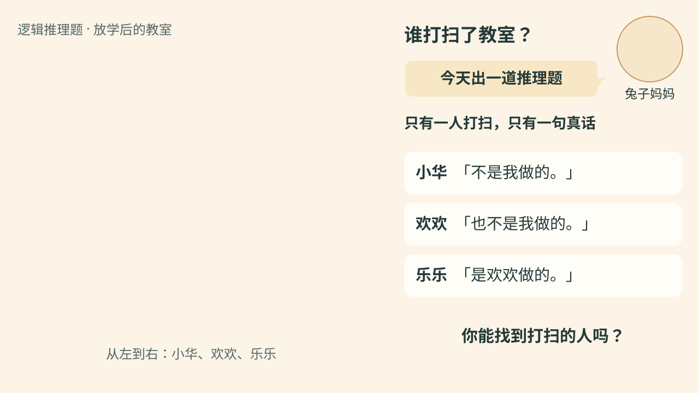

*开场图　兔子妈妈头像出镜提问，头像从开场白持续展示到读题结束。*

**兔子妈妈**：「今天出一道推理题。放学后，小华、欢欢和乐乐三个人里，只有一人打扫了教室。小华说：“不是我做的。”欢欢说：“也不是我做的。”乐乐说：“是欢欢做的。”三句话里，只有一句是真的。谁打扫了教室？」

右侧三句原话随朗读依次亮出，读完后留出思考时间。教室原图继续作为场景素材。

## 题目

放学后，小华、欢欢和乐乐三人中，**只有一人**主动打扫了教室。三个人各说了一句话，**只有一句是真话**。

- 小华说：「不是我做的。」
- 欢欢说：「也不是我做的。」
- 乐乐说：「是欢欢做的。」

**谁打扫了教室？**

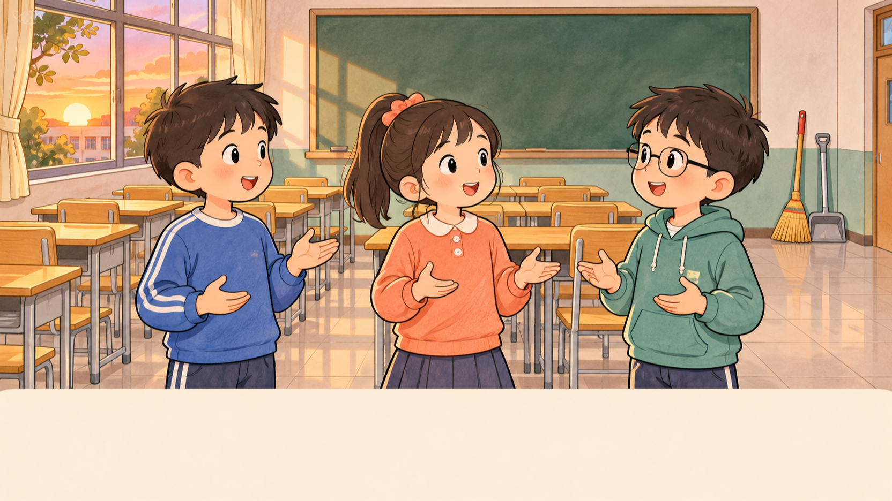

*图 1　从左到右是小华、欢欢和乐乐。*

## 解法一｜逐一假设

我们来当一回小侦探。三个人里，**一个人说真话，另外两个人说假话**。我们有一枚小天使徽章和两枚小恶魔徽章。小天使该给谁？先想一想。

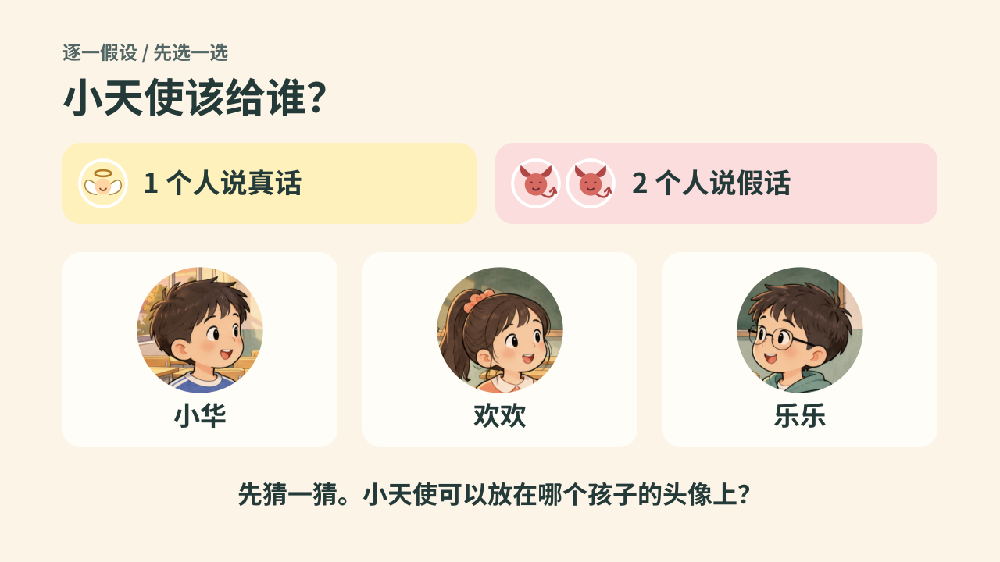

*图 2　三个孩子的头像都空着。你会先把小天使放在哪儿？*

只要选定谁戴小天使，另外两个人就都戴小恶魔。试着把小天使依次放到小华、欢欢、乐乐的头像上，就排出了下面三种假设。

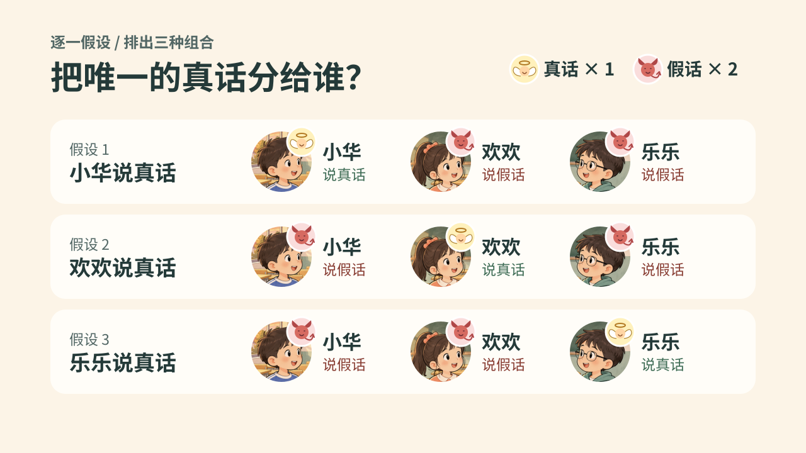

*图 3　小天使代表说真话，小恶魔代表说假话。轮流把小天使放在一个人的头像上，就排出了三种假设。*

每次先指定一个人说真话，另外两人就一定说假话。**真话照着理解，假话反过来理解。** 然后检查，这些推论能不能同时成立。

**候选人图例**：☑ 表示仅看这句话仍允许该人打扫，✖ 表示仅看这句话排除该人。每行独立判断，再找三行共同保留的人。扫帚图标表示三条推论共同确认的打扫者。

### 第一种假设｜小华说真话

如果小华说的是真话，**另外两个人的话是真是假？** 先猜一猜。

小华说真话，所以小华没打扫；仅看这句，欢欢和乐乐仍有可能。

这时欢欢和乐乐都得说假话。拿欢欢举例，她说「也不是我做的」。如果这句话是假的，就说明**欢欢确实打扫了**。

| 人物 | 原话 | 真假 | 这句话实际说明什么 | 小华 | 欢欢 | 乐乐 |
| --- | --- | :---: | --- | :---: | :---: | :---: |
| 小华 | 不是我做的。 | 真 | 小华没打扫 | ✖ | ☑ | ☑ |
| 欢欢 | 也不是我做的。 | 假 | 欢欢打扫了 | ✖ | ☑ | ✖ |
| 乐乐 | 是欢欢做的。 | 假 | 欢欢没打扫 | ☑ | ✖ | ☑ |

三条共同候选人：**无，假设不成立**。

**停一下想一想。** 欢欢能同时「打扫了」又「没打扫」吗？

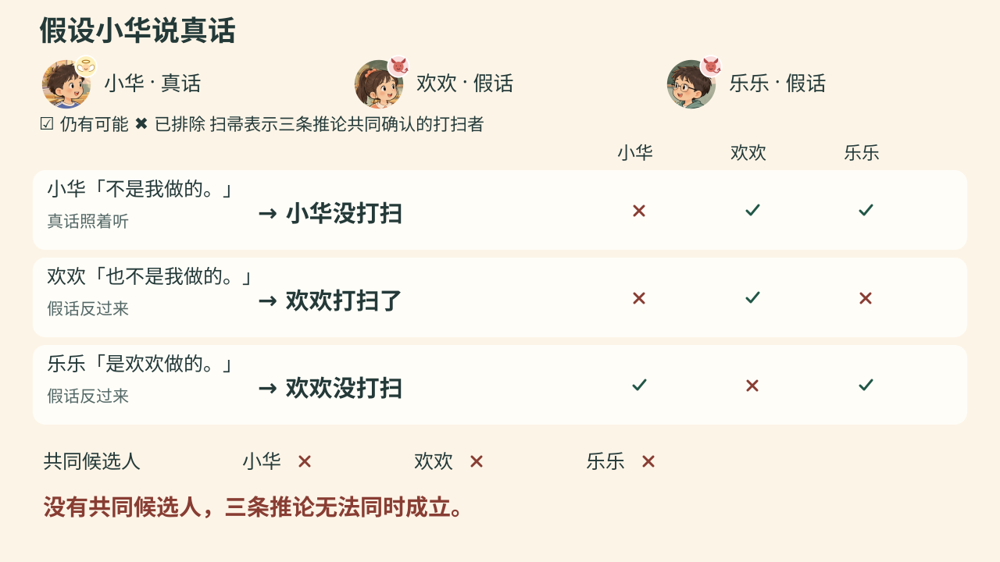

*图 4　同一件事不能既发生又没发生，小华说真话的假设不成立。*

### 第二种假设｜欢欢说真话

如果欢欢说的是真话，**另外两个人的话是真是假？** 先猜一猜。

这时小华和乐乐都得说假话。小华说「不是我做的」。把这句假话反过来，就得到**小华打扫了**。

| 人物 | 原话 | 真假 | 这句话实际说明什么 | 小华 | 欢欢 | 乐乐 |
| --- | --- | :---: | --- | :---: | :---: | :---: |
| 小华 | 不是我做的。 | 假 | 小华打扫了 | ☑ | ✖ | ✖ |
| 欢欢 | 也不是我做的。 | 真 | 欢欢没打扫 | ☑ | ✖ | ☑ |
| 乐乐 | 是欢欢做的。 | 假 | 欢欢没打扫 | ☑ | ✖ | ☑ |

三条共同候选人：**小华（配扫帚图标）**。

**停一下想一想。** 「小华打扫了」和「欢欢没打扫」能同时成立吗？这和「只有一人打扫」相符吗？

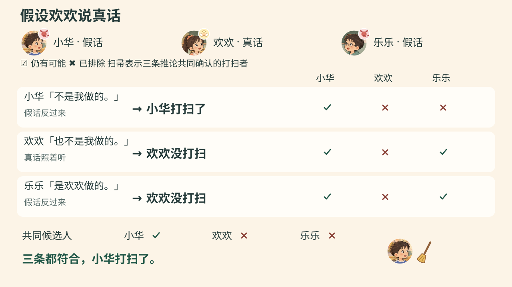

*图 5　三句话都对得上，先记下这个假设成立，再检查最后一种。*

### 第三种假设｜乐乐说真话

如果乐乐说的是真话，**另外两个人的话是真是假？** 先猜一猜。

这时小华和欢欢都得说假话。欢欢说「也不是我做的」，把这句假话反过来，就得到**欢欢打扫了**。

| 人物 | 原话 | 真假 | 这句话实际说明什么 | 小华 | 欢欢 | 乐乐 |
| --- | --- | :---: | --- | :---: | :---: | :---: |
| 小华 | 不是我做的。 | 假 | 小华打扫了 | ☑ | ✖ | ✖ |
| 欢欢 | 也不是我做的。 | 假 | 欢欢打扫了 | ✖ | ☑ | ✖ |
| 乐乐 | 是欢欢做的。 | 真 | 欢欢打扫了 | ✖ | ☑ | ✖ |

三条共同候选人：**无，假设不成立**。

**停一下想一想。** 如果小华和欢欢都打扫了，题目里的哪条条件就被破坏了？

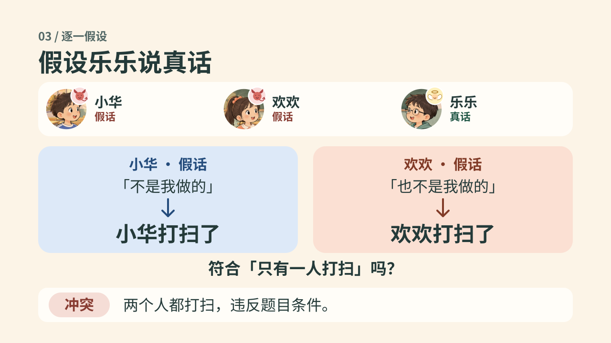

*图 6　两个人都打扫与「只有一人打扫」冲突，乐乐说真话的假设不成立。*

第一轮和第三轮没有共同候选人。第二轮只有小华同时满足三条推论，因此在图中给小华加上扫帚。

### 汇总与验算

| 假设谁说真话 | 关键推论 | 三条共同候选人 | 判断 |
| --- | --- | --- | --- |
| 小华 | 欢欢既打扫了，又没打扫 | 无 | 矛盾 |
| **欢欢** | 小华打扫了，欢欢没打扫 | **小华（扫帚）** | **成立** |
| 乐乐 | 小华和欢欢都打扫了 | 无 | 矛盾 |

三种可能都查过了，只有欢欢说真话的假设成立。**欢欢说了真话，小华打扫了教室。**

把答案代回三句原话。小华说「不是我做的」，是**假话**。欢欢说「也不是我做的」，是**真话**。乐乐说「是欢欢做的」，是**假话**。打扫的人只有小华，说真话的人只有欢欢，两个条件都满足。

## 解法二｜快速解答

**儿子**：「我发现还能更快。真相只有一个！但是解法不止一种！」

**儿子接着分析**：「先看欢欢和乐乐。欢欢说自己没打扫，乐乐说是欢欢打扫的。这两句说的是同一件事，意思正好相反，一定一真一假。题目说只有一句真话，这句真话已经在他们俩中间了。所以，小华说「不是我做的」一定是假话。反过来，就是小华打扫的！」

这里的「真相只有一个」指打扫者只有小华；「解法不止一种」承接爸爸的逐一假设法，引出儿子先找相反话的快解。

### 第一步｜找出意思正好相反的两句话

先看欢欢和乐乐。他们说的是同一件事：**欢欢到底有没有打扫教室？**

- 欢欢的意思是「打扫的人**不是欢欢**」。
- 乐乐的意思是「打扫的人**是欢欢**」。

如果欢欢打扫了，乐乐说真话，欢欢说假话。如果欢欢没打扫，欢欢说真话，乐乐说假话。两句话互为否定，所以不管谁打扫，**这两句总是一真一假**。

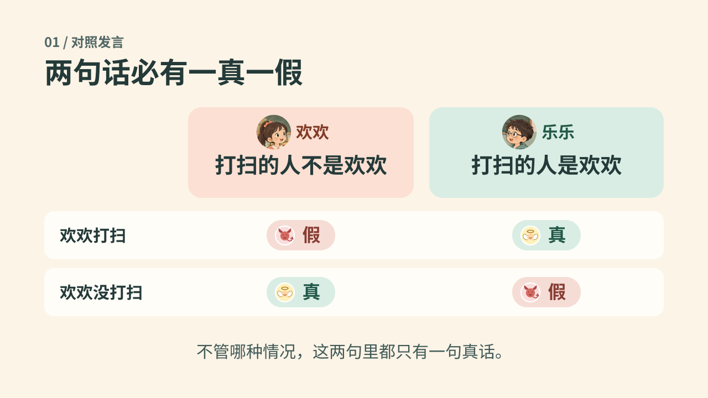

*图 7　先比较欢欢和乐乐的话，两种情况下都恰好有一句真话。*

### 第二步｜判断小华一定说假话

题目只允许一句真话，而这句真话已经在欢欢和乐乐之间了。因此，**小华说的是假话**。

### 第三步｜推出小华打扫了教室

小华说「不是我做的」。这句话是假的，实际情况就是 **小华打扫了教室**。

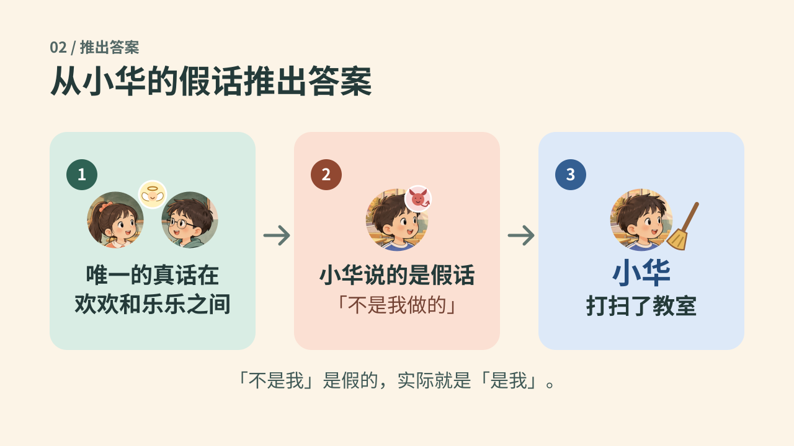

*图 8　先判断小华的话为假，再把「不是我」反过来。*

## 视频讲解提示

新版配乐顺序为：《推理 (オリジナルヴァージョン)》→《小さな巨人》→《沈む夕陽（沉落夕阳）》→《対決のテーマ》。爸爸开始说「只剩第二种。打扫教室的是小华！」时，从《小さな巨人》用约 1 秒交叉淡化切入[《沈む夕陽（沉落夕阳）》](<bgm/沈む夕陽 (沉落夕阳).m4a>)，新曲从音源开头播放，覆盖完整揭晓与真假验算，旁白期间保持低音量。验算结束、儿子开始说「我发现还能更快」时，用约 1 秒交叉淡化转入《対決のテーマ》，延续到爸爸点赞收尾。换曲由台词触发，具体时间码以后续实测配音为准，衔接处不留音乐空白。本轮仅更新文档，新版视频后续生成。

成片的角色分工、时长和制作工具见 [概要视频制作方案](谁打扫了教室_概要视频制作方案.md)。

用开场图让兔子妈妈头像出镜说「今天出一道推理题」，再依次亮出三句原话，问「谁打扫了教室？」并留出思考时间。头像持续展示到读题结束。进入解法一后，先用图 2 问「小天使该给谁？」并停一下。再切到图 3，依次亮出三种分配。每轮按小华、欢欢、乐乐的固定顺序，用图 4 至图 6 逐条亮出原话、真假、推论和三个候选人标记，再汇总共同候选人。先问这些推论能不能同时成立，再显示判断。查完三种情况，用汇总表揭晓答案，把三句原话标成「假、真、假」。最后用图 7 和图 8 回顾快解的三步。

## 快解高光与收尾插图

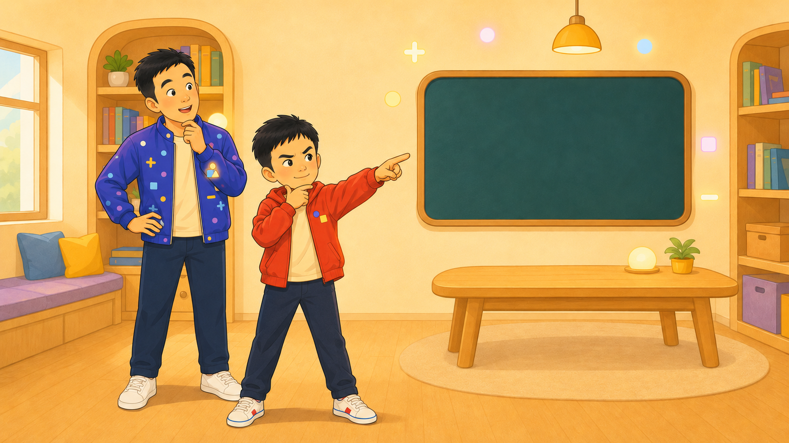

*儿子推理高光　讲解快解时使用，右侧黑板可叠加原话、真假徽章和扫帚。*

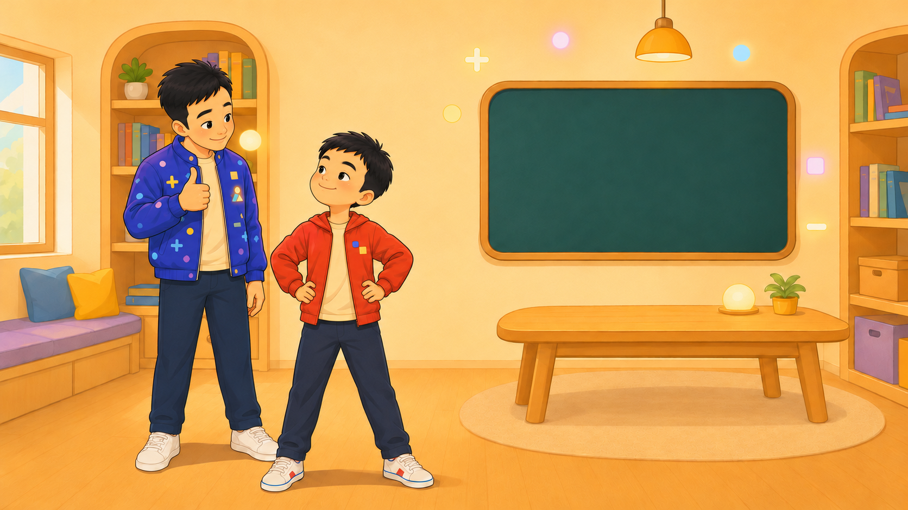

*爸爸点赞收尾　儿子完整讲完快解后切入。*

**爸爸**：「漂亮！你找到两句正好相反的话，一下就推出来了！果然长江后浪推前浪！」

爸爸说完后，父子定格约 1 秒，再淡出。两人保持自然的小幅微笑。
